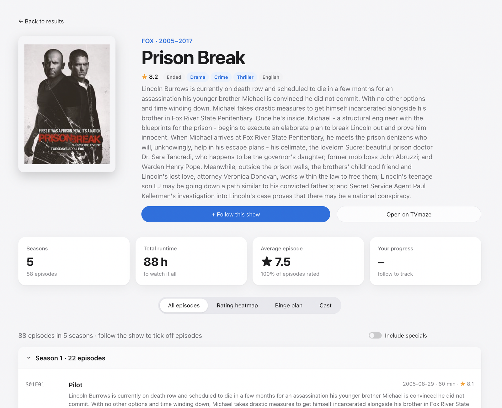

# TV Show Explorer

Search any TV show, list **all of its episodes**, and explore the data further: rating heatmaps, a binge planner, a watch tracker, cast crossovers, "six degrees" between actors and a small game. A Streamlit app built on the free [TVmaze API](https://www.tvmaze.com/api).

<!-- SCREENSHOT: docs/screenshots/episodes.png (show page, "All episodes" tab) -->
<!--  -->

## Purpose

This is my individual project on working with APIs. The assignment had one hard requirement: search for a show and list all of its episodes. I wanted to understand the TVmaze API well enough to build features on top of it that the API does not offer by itself.

| Feature | What it does |
|---|---|
| **Search & all episodes** (required) | Fuzzy search for a show, open it, and see every episode grouped by season with air date, runtime, rating and summary. Specials can be switched on. |
| Rating heatmap | One coloured cell per episode (season × episode) to spot the best and weakest stretches, plus season averages and the best / worst episode. |
| Binge plan | Total watch time and your finish date, given minutes per day, viewing weekdays and a start point (first episode, your next unwatched one, or any episode). |
| Watch tracker | Follow shows, tick off episodes (or whole seasons), see progress and "up next" on *My shows*. Export / import as JSON. |
| Spoiler-free mode | Hides summaries of episodes you have not reached yet. |
| Cast crossover | Pick two shows and see which actors were in the main cast of both, and whom they played. |
| Six degrees of TV | Connects two actors through shared shows (actor → show → actor …) with a bidirectional breadth-first search. |
| Higher or lower | Guess which of two shows has the higher TVmaze rating; keeps your best streak. |

## Data collection

All show, episode and cast data comes live from the [TVmaze API](https://www.tvmaze.com/api) while the app runs. Nothing is scraped and nothing is bundled in the repo. The API is read-only (every endpoint is a `GET` that returns JSON) and needs no key or account.

| Endpoint | Used for |
|---|---|
| `GET /search/shows?q=` | Show search (fuzzy, best match first) |
| `GET /shows/:id?embed[]=nextepisode` | Show page; `embed` adds the next airing episode in the same call |
| `GET /shows/:id/episodes` (`?specials=1`) | All episodes, heatmap, binge plan, tracker |
| `GET /shows/:id/cast` | Cast tab, crossover, six degrees |
| `GET /search/people?q=` | Actor search for six degrees |
| `GET /people/:id/castcredits?embed=show` | An actor's shows, for six degrees |
| `GET /shows?page=N` | Show index (250 IDs per page), for the game |

Every call goes through one client, `tvmaze/client.py`; no page talks to TVmaze directly. The client handles the API's rules:

- **Rate limit:** TVmaze allows about 20 calls per 10 seconds. The client keeps to 18 and waits when needed.
- **Retries:** on `429 Too Many Requests` it waits 2, 4 and 8 seconds before giving up.
- **Errors:** 404s, rate limits, server and network errors become typed exceptions (`NotFoundError`, `RateLimitError`, `ApiError`) and are shown as a message in the app instead of a crash.

The only data the user enters is search text, followed shows, watched episodes and two settings (see below).

## Data persistence

| What | Where | How long |
|---|---|---|
| API responses | In memory (the client's cache) | 1 hour (24 h for the show index); gone when the app stops. TVmaze itself caches for 60 minutes, so fresher data is not possible anyway. |
| Watch tracker: followed shows (ID and name), watched episode IDs, spoiler-free setting, best game streak | `data/tracker.json` on your computer (or the path in `TRACKER_PATH`) | Until you delete it. Move it between computers with Export / Import on *My shows*. |

There is no database or server. TVmaze's public API has no user accounts, so the tracker has to be stored locally. `data/` is git-ignored, so personal watch data never ends up in the repository.

## User interaction

The app opens in the browser, with a navigation bar at the top:

1. **Search:** type a show name and pick a result. The show page shows key figures (seasons and episodes, total runtime, average rating, your progress) and four tabs: **All episodes** (with a specials toggle), **Rating heatmap**, **Binge plan** and **Cast**. Follow the show and tick off episodes from here.
2. **My shows:** your followed shows with progress and the next episode to watch; switch on spoiler-free mode; export or import the tracker file.
3. **Crossover:** choose two shows and see shared main-cast actors.
4. **Six degrees:** choose two actors and see the chain of shows connecting them.
5. **Higher or lower:** guess which show is rated higher; one wrong guess ends the streak.
6. **About:** how the app works and the TVmaze credit.

## Setup

Requirements: Python 3.11 or newer, and an internet connection (the app calls TVmaze live; the tests do not need one). No API key, account or configuration is needed.

```bash
git clone https://github.com/YannikNMody/tv-show-explorer.git
cd tv-show-explorer
python3 -m venv .venv
source .venv/bin/activate        # Windows: .venv\Scripts\activate
pip install -r requirements.txt
streamlit run app.py
```

The app opens at http://localhost:8501.

Optional: set `TRACKER_PATH` to store the watch tracker somewhere other than `data/tracker.json`.

Run the tests:

```bash
python -m pytest -q
```

Tested with Streamlit 1.67.0, requests 2.34.2, pandas 3.1.1 and pytest 9.2.0, on Python 3.12 (GitHub Actions) and Python 3.14 (macOS).

## Learning

<!-- TODO (Yannik): write this section yourself, in your own words. -->
<!-- 1. Big picture: understanding the API's design first (what exists, how the data fits together, its rules) before deciding what to build on top of it. -->
<!-- 2. Challenge: the version mismatch (Python 3.9 on macOS vs. the Streamlit version the design needed) and how it was solved. -->

_To be written._

## Limitations and assistance

**Limitations**

- **Runs locally only.** It is not hosted; you start it on your own computer.
- **Main cast only** for crossover and six degrees. Guest roles would need one API call per episode, which the rate limit does not allow.
- **Six degrees has a budget.** Each step is one API call, so the search stops after a set number of calls (adjustable, default 150) and at most 3 shows in the chain, and can miss longer connections.
- **Ratings can be missing** on smaller shows; those cells stay grey in the heatmap.
- **Binge plan counts aired episodes only.** Announced future episodes are listed but not counted.
- **Single user.** The tracker is one file on one computer; there are no accounts or sync.
- **Not built:** two planned stretch features, a smart filter and a group picker.

**AI assistance**

All code in this project was written by AI. I used Claude chat (Opus 5.5) to brainstorm, plan the features and design, and write implementation prompts and guidelines; for this project the chat also wrote much of the code directly. Claude Code (Sonnet 5) implemented, ran, tested and committed the changes in my repository. My part was deciding what to build, making the calls when trade-offs came up, testing the results by hand, and reviewing what went into the repo. Commits made by Claude during submission prep are authored as "Claude".

**Other sources**

- Data: [TVmaze](https://www.tvmaze.com), licensed under [CC BY-SA 4.0](https://creativecommons.org/licenses/by-sa/4.0/).
- Libraries: Streamlit, requests, pandas, pytest.
- No tutorials or external code were copied in.

## Technical details

### Project structure

```
app.py                  Streamlit UI: all pages and navigation
style.css               Apple-inspired design: system font, light grey canvas, white cards, one blue accent
.streamlit/config.toml  Streamlit theme matching style.css
tvmaze/client.py        HTTP client: endpoints, cache, throttle, retries, errors
tvmaze/logic.py         Pure functions: episode grouping, heatmap, binge plan, crossover, six degrees, game
tvmaze/tracker.py       Watch tracker stored in data/tracker.json (git-ignored)
tests/                  pytest suite, runs without internet
.github/workflows/      Runs the tests on every push
```

The split keeps the logic testable: `logic.py` and `tracker.py` never touch the network or Streamlit.

### Tests

46 tests, no internet needed, run automatically on every push:

- `test_client.py`: a fake HTTP session checks caching, cache expiry, throttling, 429 retries, 404s and network errors.
- `test_logic.py`: episode grouping, heatmap data, binge maths, crossover, six degrees on a small fake TV world, game rules.
- `test_tracker.py`: saving, loading, corrupt files, follow / watched / progress.
- `test_app.py`: runs the Streamlit app against a fake TVmaze and clicks through search → show → all episodes (with and without specials), following and ticking episodes, crossover, six degrees, the game and every other page.

## Audit

Before publishing, the repository was checked for secrets, personal data, unnecessary files and documentation gaps with an AI-assisted audit. See [AUDIT.md](AUDIT.md).

## License

No license: coursework, published for grading. All rights reserved.
